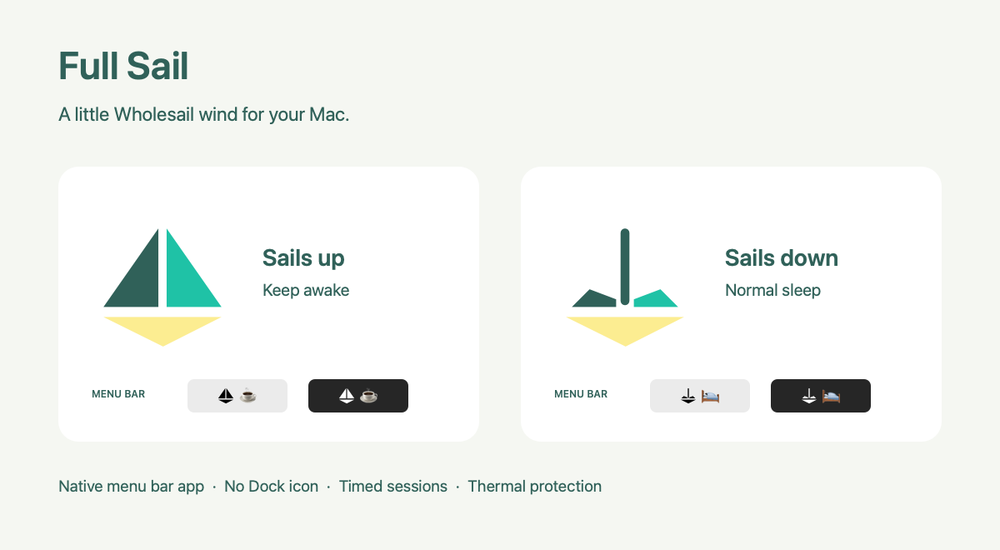

# chris-cafe

## Full Sail menu bar app

This fork adds **Full Sail**, a small native macOS menu bar companion.
The original command-line utility remains available below.



- **Sails up:** keep your Mac awake, including with the lid closed.
- **Sails down:** return to your usual sleep settings.
- Choose an indefinite session, or 15 minutes, 30 minutes, 1, 2, or 4 hours.
- Optional launch at login opens the app with sails down; it never starts a
  keep-awake session automatically.
- No Dock icon, Electron, web server, network requests, or telemetry.
- Uses the original thermal protection and display policy described below.

Full Sail exists to keep your computer running so agents can keep operating
in the background while the screen is locked. Use Lock Screen when stepping
away; Full Sail preserves your Mac's lock settings. Automatic screen locking
still follows those settings.

The color icons reinterpret Wholesail's three-triangle sailboat: full sails
for on, a bare mast and furled sails for off. The menu bar uses monochrome
template icons that follow the Mac's light or dark appearance. Status is
also available in the menu and accessibility label. Chris's original ☕ and
🛌 emojis appear beside the sail in the menu bar; guard and stop messages
keep their original emojis, such as 🦺, 💻, 🔌, 🔥, and 🌙. Sailing actions have
plain-language explanations: **Raise Sails (turn on)** and
**Lower Sails (turn off)**.

### Build and open

Requirements: macOS 13 or later, Xcode command-line tools to build, and
Python 3 to run the bundled original engine. The app checks Homebrew Python
on Apple Silicon and Intel, then `/usr/bin/python3`. A machine with only the
Apple Python stub may need command-line tools or a separate Python install.
The engine runs as your user; the app does not run as root.

```sh
./macos/build.sh               # this Mac's architecture
./macos/build.sh --universal   # Apple Silicon + Intel
open 'macos/dist/Full Sail.app'
```

If a session is running from the build folder, preserve it by building to
a separate folder, for example
`FULL_SAIL_OUTPUT_DIR="$PWD/macos/dist/v0.1.1" ./macos/build.sh --universal`.
Quit the old app before opening the new copy. The build refuses to overwrite
a running app in its output folder.

Copy `Full Sail.app` to Applications for everyday use and launch at login.
The build is ad-hoc signed for local use, not Developer ID signed or
notarized. The ZIP contains the app and its support installer; it is a
development build, not a public release.

On first use, choose **Set Up Full Sail (allow closed-lid use)…**. Open the
bundled installer and follow its administrator prompt. Full Sail checks
automatically every five seconds until setup is ready, including while its
menu is open. Then **Raise Sails (turn on)** becomes available. There is no
manual recheck step. It continues checking every 30 seconds when ready and
idle; checks pause during keep-awake sessions and never overlap.
Existing `sudo make install` users
can use the app without reinstalling if all four grants and the reset
daemon are already present. Build and tests do not install support or
change your Mac's sleep settings.

The support installer installs exactly the original sudoers rules and
boot-reset daemon. It grants `%admin` the four exact commands documented
under “chris-cafe setup”; any program running as an admin user can invoke
those commands without a password. It does not install a root Python
script, launch the app, or enable keep-awake. It refuses installation while
it detects an active engine. The boot-reset daemon clears any old override
when installed and at boot. Lower sails before installing or updating it.

### Cleanup and failures

The app waits for the engine to confirm the override was released before
quitting. It raises the sail icon only after the engine confirms the
override was set. If release fails or the engine crashes while holding it,
the menu shows a warning and offers **Restore Normal Sleep…**.

The bundled engine has two optional integration flags: `--events-json`
emits flushed JSON events to stderr, and `--parent-pid PID` exits through
the usual cleanup if its supervising app disappears. The parent check runs
each loop, after any in-progress probes, each of which has the existing
20-second timeout. A force-killed engine cannot clean itself up; the
original boot reset remains the final fallback. No automatic restart
re-enables keep-awake after a thermal shutdown or sleep.

To remove support, lower sails and quit, then run `sudo make uninstall`
from this repository. That restores normal sleep and removes the original
three paths. Delete the app and turn off its login item if enabled. The
package receipt can optionally be removed with
`sudo pkgutil --forget com.milesskorpen.fullsail.support`.

### Verification

```sh
swift test --package-path macos
python3 -m unittest discover -s tests -v
```

Swift tests cover confirmed state changes, startup cancellation, failed
cleanup, crashes, thermal-stop messaging, original status emojis, fragmented
event streams, and automatic setup detection after installation or removal.
Python tests run the actual engine loop with mocked OS probes, including
critical heat, repeated serious heat, cooling, and unreadable temperatures.
They never invoke privileged power commands. The original `make check`
remains a separate installation check and requires support to be installed.

Upstream: [pennello/chris-cafe](https://github.com/pennello/chris-cafe), by
Chris Pennello. Full Sail's native interface and vector icon variants live
under `macos/`. No license has been added to the upstream code.

## Original command-line utility

```
chris-cafe [-i INTERVAL] [-n TRIPS] [-v] [--] [COMMAND [ARG]...]
```

chris-cafe keeps the Mac awake. Run it in the foreground, and press
Ctrl-C when you want to let the machine sleep again. Given a COMMAND, it
keeps the machine awake for the lifetime of that command instead, and it
exits with the status of that command.

caffeinate cannot do this. A caffeinate assertion blocks idle sleep, and
the lid switch is a separate path in powerd that ignores every power
assertion. The one setting that blocks the lid switch is
`pmset -a disablesleep 1`. That setting applies to the whole machine and
stays set until something clears it, so chris-cafe holds it and releases
it again on the way out.

Put `--` before COMMAND when COMMAND takes options of its own. Without
the `--`, argparse reads those options as options of chris-cafe and
stops with a usage error.

The shebang is `#!/usr/bin/env python3`, so chris-cafe runs under
whichever python3 is first on PATH, and `make install` does not change
which interpreter a shell picks.

`-v` prints a sample only while the safeguard is armed. With the lid
open, or on AC power, it prints nothing, because no sample is taken.

`-i` sets the seconds between thermal samples, and the default is 60.
`-n` sets the number of consecutive hot samples that cause sleep, and
the default is 3. `-v` prints each sample.

## The thermal carve-outs

The machine stays awake for the whole run. The thermal safeguard is a
separate thing, and it is armed only when the lid is closed and the
machine is on battery. That is the case where the Mac is in a bag, with
no airflow and nobody to watch it.

The safeguard is off in the other two cases:

- The lid is open. You can see the machine, and it has airflow.
- The machine is on AC power. It is on a desk at home.

chris-cafe tests both conditions at every sample interval, so the
safeguard arms and disarms as you move through the day. Each change
prints a line, and the emoji says which condition applies.

A machine with no clamshell, such as a Mac Studio, can never be shut in
a bag, so the premise of the safeguard does not hold. chris-cafe detects
that at startup and leaves the safeguard off for the whole run, with the
television line. `ioreg` exits 0 with no output when the key is absent,
which is how absence is told apart from a failed read.

When chris-cafe cannot read the lid state or the power source, it arms
the safeguard instead of disarming it, and prints the shrug line. An
unnecessary sleep is recoverable and an overheating bag is not. A probe
that fails or times out must never look like a confident answer.

## The display policy

Closing the lid while the override is held does not turn the internal
panel off. macOS powers the panel down as part of the sleep transition,
and there is no sleep. The panel stays lit behind the closed lid and the
machine stays unlocked, which is worse than the wasted power.

chris-cafe corrects this. Every five seconds, or every interval when the
interval is shorter, it runs `pmset displaysleepnow` if the lid is
closed and the internal panel is the only display. The check has its own
cadence because the panel must not stay lit behind a closed lid for a
whole sample interval, and the lid probe that gates it costs about ten
milliseconds.

Turning the panel off also locks the machine when "Require password
immediately after sleep or screen saver begins" is set. chris-cafe does
not read that setting, so its line says only "display off".

An external display means clamshell mode, where that display is the one
the person works on, so chris-cafe leaves it alone:

```
lid     external display   action
open    any                nothing
closed  none               pmset displaysleepnow
closed  one or more        nothing
```

A display counts as external when system_profiler does not report
`spdisplays_connection_type` of `spdisplays_internal` for it. A failed
probe counts as an external display, so an uncertain answer never blanks
a screen somebody is working on.

The check repeats rather than firing on the closing edge. If something
lights the panel again, the next check puts it out. chris-cafe reads the
lid once more immediately before it blanks, because the probes before it
cost about a third of a second and the lid can open inside that window.

`pmset displaysleepnow` needs no privilege, so it needs no sudoers rule.

The powerd assertion that reports whether the panel is lit decides only
whether the check is worth doing now, and whether to print a line. At
every sample interval the blanking runs whatever that assertion says, so
a rename of it inside macOS cannot silently leave the panel lit.

CAUTION: `AppleClamshellCausesSleep` on IOPMrootDomain looks like the
correct signal and is not. It reads `Yes` with an external display
attached and the lid open, so it does not separate the two cases. Do not
use it.

chris-cafe does nothing about the display while the lid is open. The
display sleep timer of macOS and the screen lock settings own that case.

## The override can be cleared underneath you

`disablesleep` is one machine-wide setting, and anything can clear it.
`sudo make install` does exactly that: bootstrapping the reset daemon
runs it at install time, not only at boot. chris-cafe reads the setting
back at every sample interval and sets it again when it finds it
cleared, with the repeat-arrows line. `make install` also warns when an
instance is running.

## Probes and timeouts

Every probe runs with a 20-second timeout, and a timeout counts as a
failed probe. Without one, a wedged `system_profiler` would stall the
loop with the override held and no thermal sampling at all.

A sleep shorter than five seconds is not detected. The gap between the
two clocks has to clear that threshold before the `kern.waketime` check
runs at all.

A wrapped COMMAND gets SIGTERM, then SIGKILL ten seconds later. The
release of the override happens first and never waits on the command,
because a command that ignores SIGTERM must not be able to strand the
setting.

## One instance at a time

The sleep override is one machine-wide setting rather than a count. Two
instances would both set it, and the first to exit would clear it while
the second still believed it held the machine awake. chris-cafe takes an
exclusive lock on `/Users/Shared/.chris-cafe.lock` before it changes
anything. A second instance prints the pid of the first and exits 1.

The lock is not in `/tmp` or `$TMPDIR`, because macOS deletes old files
from both. `/usr/libexec/tmp_cleaner` runs at midnight and deletes a
file in `/tmp` when its atime, mtime and ctime are all more than three
days old. `dirhelper` does the same to `$TMPDIR` at 03:35. chris-cafe
writes the lock only at startup, so an instance that runs over a weekend
lost its lock file to `tmp_cleaner`. `/Users/Shared` has the same mode
as `/tmp` and no cleaner. The leading dot keeps the file out of Finder.

The lock is a flock rather than a pid file, so the kernel drops it when
the process dies, including under SIGKILL. There is no stale lock to
clean up after a crash.

After it takes the lock, chris-cafe checks that the inode it locked is
still the one at that path. Somebody who deletes the file can still let
a second instance create and lock a new one, so chris-cafe re-checks at
every sample interval and says so, once, when the file was replaced.
The locked inode cannot come back to the path, so the check stops after
the first warning. Re-taking the override each interval limits what a
second instance costs.

CAUTION: /Users/Shared is world-writable. The lock file is opened with
`O_NOFOLLOW` and refused unless it is a regular file owned by you or by
root. Without that, another local user could point the name at one of
your files and chris-cafe would truncate it. The pid is read back at
most 32 bytes and printed only when it is all digits, because anybody
can write that file and a terminal acts on an escape sequence.

## The thermal safeguard

While the safeguard is armed, chris-cafe reads the thermal pressure
level from powermetrics. The levels are Nominal, Fair, Serious and
Critical. A Critical sample puts the machine to sleep at once. A Serious
sample must repeat TRIPS times in a row first, because a heavy build,
such as a Monolith compile, reaches Serious for a short time with no
risk. A cooler sample resets the count, and so does a change in the
carve-out state.

Before it sleeps the machine, chris-cafe stops COMMAND, releases the
override, and then runs `pmset sleepnow`. The order is necessary,
because sleepnow does nothing while the override is set.

chris-cafe also stops when it cannot read the level TRIPS times in a
row. Without the sample there is no safeguard, and the override must not
stay in place without one.

## What happens when the machine sleeps

chris-cafe stops when the machine sleeps, whatever caused the sleep. The
contract of the script is that the machine stays awake while it runs, so
a sleep means something outside the script overrode it. The honest
answer is to release the override and exit, rather than to wake up still
holding a setting the script did not choose. Run chris-cafe again after
the wake.

The detection costs nothing in the normal case. `time.monotonic()` stops
while the machine sleeps and `time.time()` does not, so a gap between
the two means the machine slept. A clock correction makes the same gap,
so chris-cafe confirms the gap against `kern.waketime` from sysctl
before it acts. That confirmation runs only when a gap appears.

## The chris-cafe log lines

chris-cafe writes its own lines to stderr. Each line starts with an
emoji for the kind of event, and no two kinds share one:

- A coffee cup, when it disables sleep.
- A bed, when it enables sleep again.
- A safety vest, when the thermal safeguard arms.
- A laptop, when the safeguard is off because the lid is open.
- A plug, when the safeguard is off because the machine is on AC power.
- A television, when the safeguard is off because the machine has no lid.
- A shrug, when it cannot read the lid state, the power source, or the
  wake time.
- Repeat arrows, when it finds the override cleared and sets it again.
- A bar chart, for each sample under `-v`.
- A flame, when the machine is too hot and goes to sleep.
- A moon, when the machine slept and chris-cafe stops.
- A monkey, when chris-cafe loses the thermal reading and stops.
- A no-entry sign, when chris-cafe refuses to start.
- A padlock, when it turns the display off.
- A cross, when COMMAND cannot run.
- An exclamation mark, when the release of the override fails.
- A light bulb, for the line that tells you what to do about it.

Every one of these is an East Asian Wide code point, so the terminal
advances two cells and the lines stay in one column. Keep that property
when you change a leader. A Neutral-width code point, such as the
thermometer or the warning triangle, leaves a ragged column, and U+FE0F
does not correct it: the variation selector picks the glyph, not the
cell count.

The exit status:

- The exit status of COMMAND, when it exited on its own.
- 128 plus the signal number, when a signal killed COMMAND, and likewise
  when a signal stops chris-cafe itself.
- 130, when you pressed Ctrl-C.
- 125, when the thermal safeguard put the machine to sleep.
- 124, when the machine slept for another reason.
- 127, when COMMAND was not found, and 126 when COMMAND cannot run.
- 1, when another instance already holds the override.
- 1, when a pmset or powermetrics call failed, when the release of the
  override failed, or when the thermal safeguard could not sleep the
  machine. A failed release also prints what to run by hand.
- 2, for a usage error.

## chris-cafe setup

`sudo make install` puts three files in place:

- `/usr/local/bin/chris-cafe`, the script.
- `/etc/sudoers.d/chris-cafe`, four NOPASSWD rules.
- `/Library/LaunchDaemons/com.chrispennello.chris-cafe.reset.plist`,
  which clears the override at every boot.

`sudo make uninstall` clears the override, unloads the daemon, and
removes the three files.

The sudoers rules are necessary because the script runs unattended with
the lid closed, where a sudo password prompt has nobody to answer it.
The rules name four exact argument vectors, so they grant those four
calls and nothing else. The powermetrics rule grants one sampling
command, not the tool.

Four constants in the script hold those same four vectors: HOLD,
RELEASE, SLEEPNOW and SAMPLE. `chris-cafe --vectors` prints them, and
`make check` requires the sudoers file to carry each one, so the
coupling below is machine-checked rather than remembered.

CAUTION: sudoers matches arguments literally. Change a constant in the
script and the matching line in chris-cafe.sudoers together. A change to
one of the two alone brings back the password prompt that the rules
exist to prevent.

NOPASSWD removes the password prompt and the terminal requirement
together. Any code running under an admin account, including a package
install script or an editor extension, can then set the override or
sleep the machine with no prompt. Neither raises privilege, because an
admin already holds full sudo with a password, but the reachability is
different. The grant is to %admin rather than to one user.

The lid state, the power source and the wake time need no rule.
chris-cafe reads them with ioreg, `pmset -g batt` and sysctl, and none
of the three needs root.

The LaunchDaemon is necessary because the disablesleep setting survives
a reboot, and a panic or a `kill -9` leaves it set. The daemon runs
`pmset -a disablesleep 0` at every boot, so the Mac always starts with
regular sleep behavior, until you run chris-cafe again.

Run `make check` as yourself to confirm both. It refuses to run as root,
because every sudo test passes as root and proves nothing. It tests all
four grants with `sudo -k -n -l`, which asks the policy whether the
command is permitted without running it and without consulting a cached
sudo timestamp, and it confirms that launchd loaded the daemon and
reports its last exit code.
